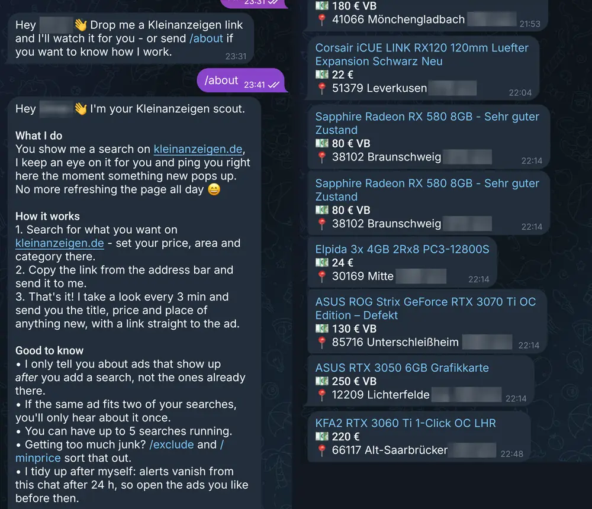
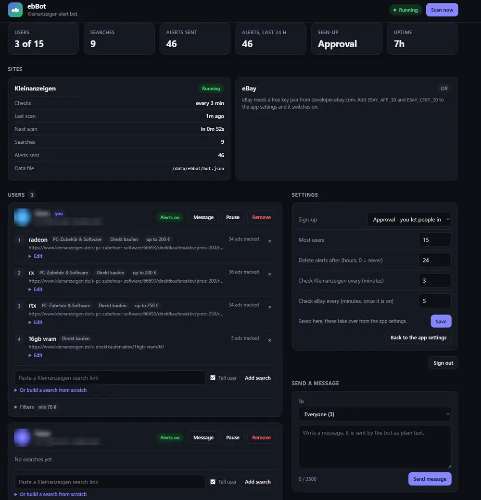

# ebBot - Kleinanzeigen alerts in Telegram

[](LICENSE)
[](https://www.python.org/)
[](#with-docker-recommended)
[](https://github.com/Homura3/kleinanzeigen-telegram-bot/stargazers)

> Never miss a deal again: new Kleinanzeigen ads straight to Telegram, filtered your way.
> **Deutsch:** Telegram-Bot, der dich sofort über neue Anzeigen auf Kleinanzeigen (und optional eBay.de) informiert.

A small Telegram bot that watches searches on [kleinanzeigen.de](https://www.kleinanzeigen.de) and
messages you the moment a new ad shows up. Optionally it watches ebay.de too.

It is one Python file with two dependencies, keeps its data in plain JSON files and runs fine on a
Raspberry Pi, a NAS or any small server.



<details>
<summary>Admin dashboard</summary>



</details>

## What it does

- **Alerts for new ads.** Add a search and the bot tells you about every ad that appears after that.
- **Three ways to add a search:** just write what you are looking for, build one step by step with
  `/new` (words, category, budget, place), or paste a search link from the site with all your filters.
- **Filters:** skip ads containing certain words (`/exclude`) or below a price (`/minprice`).
- **Several users.** Friends can use the same bot. By default each new person has to be approved by
  the admin first.
- **Tidy chats.** Alerts are deleted again after 24 hours (configurable), and an ad matching two of
  your searches is only sent once.
- **Admin dashboard.** A password-protected web page to approve people, look at users and searches,
  and change the bot's settings. It can be added to a phone's home screen.
- **Looks after itself.** If scans start failing or the site blocks the bot, it backs off and warns
  the admin, then says when things work again.
- **Optional eBay.** With a free eBay developer key the bot also watches ebay.de searches through
  eBay's official Browse API.

### Chat commands

| Command | What it does |
|---|---|
| `/new` | Build a search step by step |
| `/add` | Watch a search (or just paste the link) |
| `/list` | Your searches and filters |
| `/show` | See what is up right now in a search |
| `/edit` | Change one of your searches |
| `/remove` | Stop watching a search |
| `/exclude` | Skip ads with certain words |
| `/minprice` | Skip ads below a price |
| `/pause`, `/resume` | Mute and unmute alerts |
| `/about`, `/help` | How the bot works, and help for each command |

## Setup

You need two things from Telegram:

1. **A bot token.** Message [@BotFather](https://t.me/BotFather), send `/newbot` and follow the steps.
2. **Your own user ID.** Message [@userinfobot](https://t.me/userinfobot); it replies with your ID.
   This account becomes the bot's admin.

### With Docker (recommended)

```sh
git clone https://github.com/Homura3/kleinanzeigen-telegram-bot.git
cd kleinanzeigen-telegram-bot
cp .env.example .env      # then fill in TOKEN, CHAT_ID and ADMIN_PASSWORD
docker compose up -d --build
```

The bot's data lands in `./data`. The dashboard is at `http://<your-server>:8080`.

### Without Docker

The bot is developed and run on Python 3.11.

```sh
pip install -r requirements.txt
export TOKEN=...            # from @BotFather
export CHAT_ID=...          # your Telegram user ID
export ADMIN_PASSWORD=...   # optional, turns the dashboard on
python3 bot.py
```

Then open your bot in Telegram and press **Start**.

## Settings

All settings are environment variables. Only `TOKEN` is required; set `CHAT_ID` as well so the bot
has an admin.

| Variable | Default | Meaning |
|---|---|---|
| `TOKEN` | - | Bot token from @BotFather |
| `CHAT_ID` | - | Telegram user ID of the admin |
| `ADMIN_PASSWORD` | off | Password for the dashboard (10+ characters). Empty turns the dashboard off |
| `ALLOWED_IDS` | - | User IDs that may use the bot without approval, comma-separated |
| `APPROVAL` | `1` | New people need the admin's approval. `0` opens sign-up to everyone |
| `INTERVAL` | `600` | Seconds between Kleinanzeigen scans |
| `MAX_LINKS` | `5` | Searches per user (per site) |
| `MAX_USERS` | `50` | Most people the bot serves |
| `MAX_PER_CYCLE` | `10` | Most alerts sent per search in one scan |
| `ALERT_HOURS` | `24` | Hours until alerts are deleted from the chats. `0` keeps them; Telegram's limit is 48 |
| `DATA_DIR` | `~/ebbot` | Where the bot keeps its data (`/data` in the Docker image) |
| `DASHBOARD_PORT` | `8080` | Port of the dashboard |
| `EBAY_DATA_DIR` | - | Folder for the eBay data, for example `/data/ebay` |
| `EBAY_APP_ID`, `EBAY_CERT_ID` | - | Keys from [developer.ebay.com](https://developer.ebay.com) |
| `EBAY_INTERVAL` | `300` | Seconds between eBay scans |

eBay switches on once `EBAY_DATA_DIR`, `EBAY_APP_ID` and `EBAY_CERT_ID` are all set. Some of these
values can also be changed later on the dashboard.

## Good to know

- **Keep the dashboard private.** It speaks plain HTTP. Reach it over your home network or a VPN, or
  put it behind a reverse proxy with HTTPS before exposing it to the internet.
- **Be gentle.** The bot reads Kleinanzeigen's public search pages. Keep the scan interval moderate;
  very short intervals get the bot blocked.
- **Not affiliated.** This is a private hobby project. It is not connected to or endorsed by
  Kleinanzeigen, eBay or Telegram, and automated access may be against a site's terms of use.
  Use it at your own risk.

## Contributing

Bug reports, ideas and pull requests are welcome. Open an [issue](https://github.com/Homura3/kleinanzeigen-telegram-bot/issues).
If the bot is useful to you, a ⭐ helps other people find it.

## Licence

[MIT](LICENSE)
